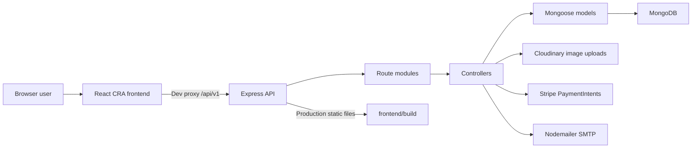
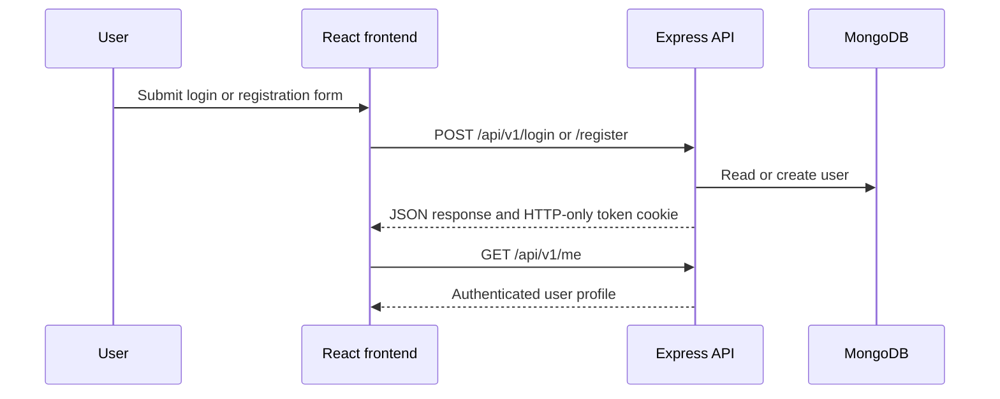
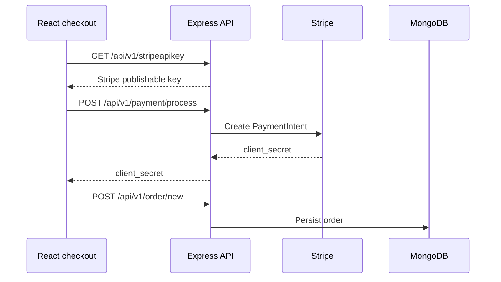

# Shopie

Shopie is a MERN e-commerce application with a React storefront, an Express API, MongoDB persistence, JWT cookie authentication, Stripe payment intent creation, Cloudinary-backed image uploads, and admin workflows for products, users, orders, and reviews.

This README reflects the current repository implementation. Any remaining engineering follow-up is called out explicitly instead of being presented as complete.

## Table of Contents

- [Architecture](#architecture)
- [Implemented Features](#implemented-features)
- [Tech Stack](#tech-stack)
- [Project Structure](#project-structure)
- [API Reference](#api-reference)
- [Core Workflows](#core-workflows)
- [Local Development](#local-development)
- [Environment Variables](#environment-variables)
- [Scripts](#scripts)
- [Production Notes](#production-notes)
- [Repository Quality Notes](#repository-quality-notes)
- [Current Scope Notes](#current-scope-notes)

## Architecture



### Runtime Model

- In development, the backend runs on `http://localhost:4000` and the frontend runs on `http://localhost:3000`.
- The frontend proxies `/api/v1/*` requests to the backend through [frontend/src/setupProxy.js](frontend/src/setupProxy.js).
- In production, [backend/app.js](backend/app.js) serves the compiled React app from `frontend/build` and mounts API routes under `/api/v1`.
- Backend configuration is loaded from `backend/config/config.env` when `NODE_ENV` is not `PRODUCTION`.

See [docs/architecture.md](docs/architecture.md) for deeper request flows, dependency boundaries, and model notes.

## Implemented Features

- Public product catalog with search, filtering, pagination, and product detail pages.
- User registration, login, logout, profile retrieval, profile update, password update, forgot password, and reset password.
- JWT authentication stored in an HTTP-only cookie.
- Product reviews for authenticated users.
- Cart and checkout flow in the frontend.
- Stripe PaymentIntent creation for INR payments.
- Admin product, user, order, and review management routes.
- Cloudinary uploads for product images and profile avatars when Cloudinary credentials are configured.
- Password recovery email delivery through Nodemailer SMTP settings.

## Tech Stack

| Layer | Technologies |
| --- | --- |
| Backend | Node.js, Express, Mongoose, MongoDB, JWT, bcryptjs, cookie-parser |
| Frontend | React 17, Create React App, Redux, React Router v5, Axios, Material UI, Stripe Elements |
| Payments | Stripe PaymentIntents |
| Media | Cloudinary |
| Email | Nodemailer SMTP transport |
| Deployment support | `Procfile`, `render-postbuild`, `vercel.json` |

## Project Structure

Generated dependency folders and build artifacts are intentionally omitted from this source tree.

```text
.
|-- .gitignore
|-- .env.example
|-- Procfile
|-- README.md
|-- docs
|   |-- architecture.md
|   `-- deployment.md
|-- package.json
|-- vercel.json
|-- backend
|   |-- app.js
|   |-- server.js
|   |-- config
|   |   |-- config.env.example
|   |   `-- database.js
|   |-- controllers
|   |   |-- orderController.js
|   |   |-- paymentController.js
|   |   |-- productController.js
|   |   `-- userController.js
|   |-- middleware
|   |   |-- auth.js
|   |   |-- catchAsyncErrors.js
|   |   `-- error.js
|   |-- models
|   |   |-- orderModels.js
|   |   |-- productModel.js
|   |   `-- userModel.js
|   |-- routes
|   |   |-- orderRoute.js
|   |   |-- paymentRoute.js
|   |   |-- productRoute.js
|   |   `-- userRoute.js
|   `-- utils
|       |-- ApiFeatures.js
|       |-- errorhandler.js
|       |-- jwtToken.js
|       `-- sendEmail.js
`-- frontend
    |-- package.json
    |-- public
    |   |-- index.html
    |   |-- logo192.png
    |   |-- logo512.png
    |   |-- manifest.json
    |   `-- robots.txt
    `-- src
        |-- App.js
        |-- Store.js
        |-- actions
        |   |-- cartAction.js
        |   |-- orderAction.js
        |   |-- productAction.js
        |   `-- userAction.js
        |-- component
        |   |-- Cart
        |   |-- Home
        |   |-- Order
        |   |-- Product
        |   |-- Route
        |   |-- User
        |   |-- admin
        |   `-- layout
        |       |-- About
        |       |-- Alert
        |       |-- Contact
        |       |-- Footer
        |       |-- Header
        |       |-- Loader
        |       `-- MetaData.js
        |-- constants
        |   |-- cartConstants.js
        |   |-- orderConstants.js
        |   |-- productConstants.js
        |   `-- userConstant.js
        |-- reducers
        |   |-- cartReducer.js
        |   |-- orderReducer.js
        |   |-- productReducers.js
        |   `-- userReducer.js
        `-- setupProxy.js
```

## API Reference

All endpoints are mounted under `/api/v1`.

### User Routes

| Method | Endpoint | Auth | Controller |
| --- | --- | --- | --- |
| `POST` | `/register` | Public | `registerUser` |
| `POST` | `/login` | Public | `loginUser` |
| `GET` | `/logout` | Public | `logout` |
| `POST` | `/password/forgot` | Public | `forgotPassword` |
| `PUT` | `/password/reset/:token` | Public | `resetPassword` |
| `GET` | `/me` | User | `getUserDetails` |
| `PUT` | `/password/update` | User | `updatePassword` |
| `PUT` | `/me/update` | User | `updateProfile` |
| `GET` | `/admin/users` | Admin | `getAllUsers` |
| `GET` | `/admin/user/:id` | Admin | `getSingleUser` |
| `PUT` | `/admin/user/:id` | Admin | `updateUserRole` |
| `DELETE` | `/admin/user/:id` | Admin | `deleteUser` |

### Product Routes

| Method | Endpoint | Auth | Controller |
| --- | --- | --- | --- |
| `GET` | `/products` | Public | `getAllProducts` |
| `GET` | `/product/:id` | Public | `getProductDetails` |
| `PUT` | `/review` | User | `createProductReview` |
| `GET` | `/reviews?id=:productId` | Public | `getProductReviews` |
| `DELETE` | `/reviews?productId=:productId&id=:reviewId` | User | `deleteReview` |
| `GET` | `/admin/products` | Admin | `getAdminProducts` |
| `POST` | `/admin/product/new` | Admin | `createProduct` |
| `PUT` | `/admin/product/:id` | Admin | `updateProduct` |
| `DELETE` | `/admin/product/:id` | Admin | `deleteProduct` |

### Order Routes

| Method | Endpoint | Auth | Controller |
| --- | --- | --- | --- |
| `POST` | `/order/new` | User | `newOrder` |
| `GET` | `/order/:id` | User | `getSingleOrder` |
| `GET` | `/orders/me` | User | `myOrders` |
| `GET` | `/admin/orders` | Admin | `getAllOrders` |
| `PUT` | `/admin/order/:id` | Admin | `updateOrder` |
| `DELETE` | `/admin/order/:id` | Admin | `deleteOrder` |

### Payment Routes

| Method | Endpoint | Auth | Controller |
| --- | --- | --- | --- |
| `POST` | `/payment/process` | User | `processPayment` |
| `GET` | `/stripeapikey` | User | `sendStripeApiKey` |

## Core Workflows

### Authentication



### Checkout and Payment



### Product Administration

- Admin routes are protected by `isAuthenticatedUser` and `authorizeRoles("admin")`.
- Product create and update requests upload image payloads to Cloudinary.
- Product deletion destroys Cloudinary image assets before removing the MongoDB document.

### Password Recovery

- `POST /password/forgot` creates a reset token on the user document.
- The reset URL uses `FRONTEND_URL` when configured, otherwise it falls back to the current request host.
- The email is sent through `backend/utils/sendEmail.js` using preferred `SMTP_*` variables with legacy `SMPT_*` fallback support.

## Local Development

### Prerequisites

- Node.js and npm.
- MongoDB URI, either local MongoDB or MongoDB Atlas.
- Stripe test keys for payment flow.
- Cloudinary credentials for product image upload and hosted avatar uploads.
- SMTP credentials for forgot-password email flow.

### Install Dependencies

```bash
npm install
npm install --prefix frontend
```

### Configure Environment

```bash
cp backend/config/config.env.example backend/config/config.env
```

Update `backend/config/config.env` with local credentials. Do not commit that file.

### Run Backend and Frontend on Different Ports

Terminal 1:

```bash
npm run dev
```

Terminal 2:

```bash
API_PROXY_TARGET=http://localhost:4000 npm start --prefix frontend
```

Expected local URLs:

- Backend API: `http://localhost:4000/api/v1`
- Frontend app: `http://localhost:3000`

## Environment Variables

The backend currently reads `backend/config/config.env` in non-production mode. Templates are available at [.env.example](.env.example) and [backend/config/config.env.example](backend/config/config.env.example).

| Variable | Required | Purpose |
| --- | --- | --- |
| `PORT` | Yes | Express server port, usually `4000` locally |
| `NODE_ENV` | Yes | `DEVELOPMENT` or `PRODUCTION` |
| `DB_URI` | Yes | MongoDB connection string |
| `FRONTEND_URL` | Password email | Frontend origin used for password reset links |
| `JWT_SECRET` | Yes | JWT signing secret |
| `JWT_EXPIRE` | Yes | JWT expiration, for example `5d` |
| `COOKIE_EXPIRE` | Yes | Cookie lifetime in days |
| `CLOUDINARY_NAME` | Product uploads | Cloudinary cloud name |
| `CLOUDINARY_API_KEY` | Product uploads | Cloudinary API key |
| `CLOUDINARY_API_SECRET` | Product uploads | Cloudinary API secret |
| `SMTP_SERVICE` | Password email | SMTP service name used by Nodemailer |
| `SMTP_MAIL` | Password email | SMTP sender account |
| `SMTP_PASSWORD` | Password email | SMTP account password or app password |
| `SMPT_SERVICE` | Legacy password email | Legacy fallback for existing Render environments |
| `SMPT_MAIL` | Legacy password email | Legacy fallback for existing Render environments |
| `SMPT_PASSWORD` | Legacy password email | Legacy fallback for existing Render environments |
| `STRIPE_API_KEY` | Payments | Stripe publishable key returned to frontend |
| `STRIPE_SECRET_KEY` | Payments | Stripe secret key used by backend |

## Scripts

Root package:

| Command | Description |
| --- | --- |
| `npm run dev` | Start backend with Nodemon |
| `npm start` | Start backend with Node |
| `npm run check:backend` | Syntax-check backend JavaScript files |
| `npm run check:frontend` | Build the frontend production bundle |
| `npm run check:secrets` | Scan tracked and untracked source files for common secret patterns |
| `npm run test:backend` | Run backend API smoke tests |
| `npm run test:frontend` | Run frontend route smoke tests |
| `npm run render-postbuild` | Install frontend dependencies and build the React app for Render-style deployment |
| `npm test` | Run backend syntax, backend smoke, and frontend route smoke checks |

Frontend package:

| Command | Description |
| --- | --- |
| `npm start --prefix frontend` | Start Create React App dev server |
| `npm run build --prefix frontend` | Build frontend production bundle |
| `npm test --prefix frontend` | Run CRA test command |

## Production Notes

See [docs/deployment.md](docs/deployment.md) for deployment steps and environment checklists.

At a high level:

1. Install root dependencies.
2. Install frontend dependencies.
3. Build the frontend with `npm run build --prefix frontend`.
4. Provide production environment variables in the hosting platform.
5. Start the app with `npm start`.

The Express server serves the frontend build in production, so a single Node service can host both API and compiled UI.

## Repository Quality

- `.gitignore` excludes local environment files and dependency folders.
- `backend/config/config.env` is intentionally not committed.
- `.env.example` files contain placeholders only.
- GitHub issue templates, pull request template, CI workflow, `CONTRIBUTING.md`, `SECURITY.md`, and `LICENSE` are present.
- The CI workflow installs dependencies, runs backend syntax checks, backend smoke tests, frontend route smoke tests, secret scanning, and frontend production build.

## Current Scope

- Current automated tests are smoke-level checks. They do not replace full database-backed integration tests.
- The rate limiter is in-memory and intended for the current single Render web service deployment model.
- Security reporting guidance is documented in `SECURITY.md`.
