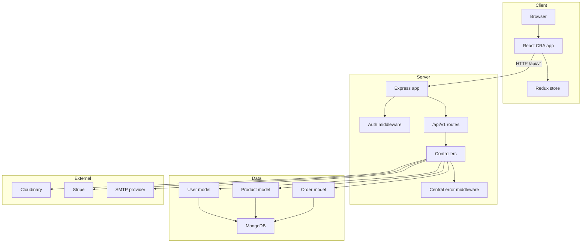
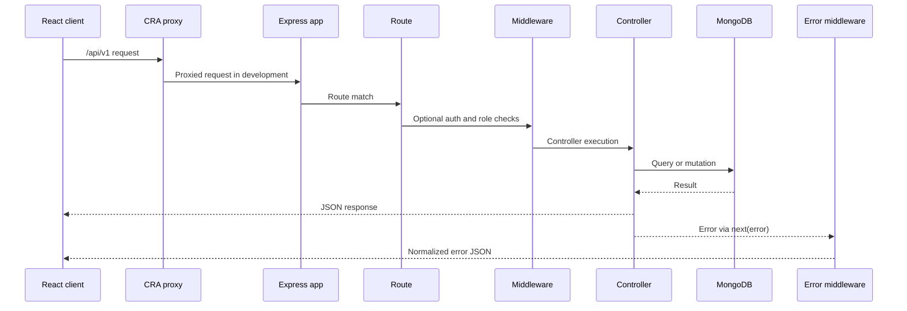
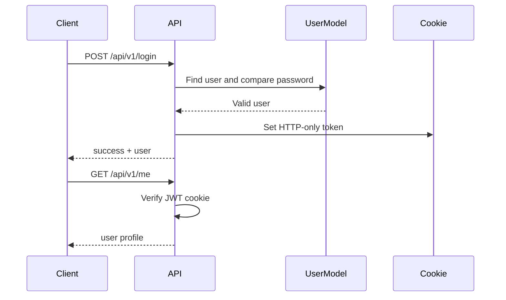
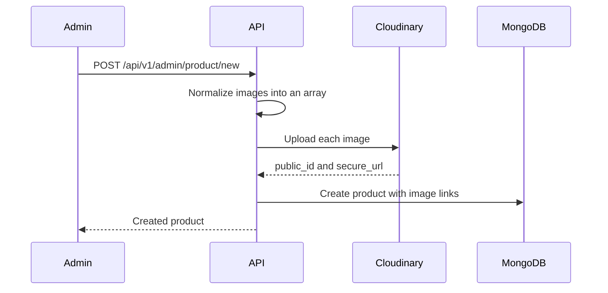
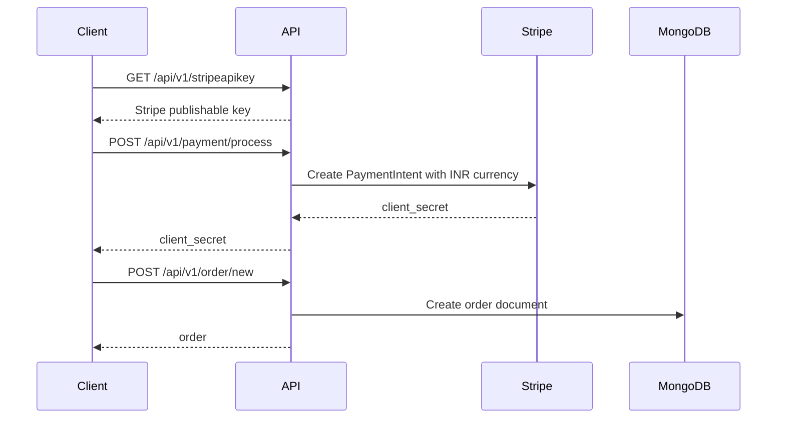

# Architecture

This document describes the architecture currently implemented in the Shopie repository. It is based on the actual route, controller, model, and configuration files in the codebase.

## System Overview

Shopie is a MERN application with a React single-page app and a Node/Express API. The backend owns authentication, product data, order data, image upload integration, payment intent creation, and email delivery.



## Backend Composition

| Area | File(s) | Responsibility |
| --- | --- | --- |
| Server bootstrap | `backend/server.js` | Loads env, connects MongoDB, configures Cloudinary, starts Express |
| Express app | `backend/app.js` | Middleware, route mounting, static frontend serving, error middleware |
| Database | `backend/config/database.js` | Mongoose connection using `DB_URI` |
| Auth middleware | `backend/middleware/auth.js` | JWT cookie validation and role authorization |
| Error handling | `backend/middleware/error.js` | Centralized API error responses |
| Async wrapper | `backend/middleware/catchAsyncErrors.js` | Wraps async controller errors |
| User module | `backend/routes/userRoute.js`, `backend/controllers/userController.js`, `backend/models/userModel.js` | Auth, profile, password reset, admin user management |
| Product module | `backend/routes/productRoute.js`, `backend/controllers/productController.js`, `backend/models/productModel.js` | Catalog, reviews, admin product management |
| Order module | `backend/routes/orderRoute.js`, `backend/controllers/orderController.js`, `backend/models/orderModels.js` | User orders and admin order processing |
| Payment module | `backend/routes/paymentRoute.js`, `backend/controllers/paymentController.js` | Stripe key exposure and PaymentIntent creation |
| Email utility | `backend/utils/sendEmail.js` | Nodemailer SMTP delivery |
| JWT utility | `backend/utils/jwtToken.js` | Creates JWT and writes token cookie |
| Query utility | `backend/utils/ApiFeatures.js` | Product search, filter, and pagination |

## Frontend Composition

| Area | File(s) | Responsibility |
| --- | --- | --- |
| App routes | `frontend/src/App.js` | React Router route definitions and Stripe Elements wrapper |
| Store | `frontend/src/Store.js` | Redux store setup |
| API actions | `frontend/src/actions` | Axios-backed Redux actions |
| Reducers | `frontend/src/reducers` | Redux state transitions |
| Constants | `frontend/src/constants` | Redux action constants |
| Proxy | `frontend/src/setupProxy.js` | Proxies `/api/v1` to the backend in local development |
| UI components | `frontend/src/component` | Storefront, cart, user, admin, order, and layout screens |

## Request Lifecycle



## Authentication Flow

1. The user posts credentials to `/api/v1/login`, or registration data to `/api/v1/register`.
2. The backend validates or creates the user.
3. `backend/utils/jwtToken.js` signs a JWT using `JWT_SECRET`.
4. The token is stored in an HTTP-only cookie named `token`.
5. Protected routes use `isAuthenticatedUser` to verify the cookie and populate `req.user`.
6. Admin routes also use `authorizeRoles("admin")`.



## Product Discovery Flow

`GET /api/v1/products` uses `ApiFeatures` to apply:

- Keyword search against product `name`.
- Filtering with query operators such as `gte`, `lte`, `gt`, and `lt`.
- Pagination with a fixed `resultPerPage` value of `12`.

Example query:

```text
GET /api/v1/products?keyword=phone&price[gte]=1000&page=1
```

## Product Image Flow



Notes:

- Product image upload requires valid Cloudinary credentials.
- Product deletion attempts to destroy Cloudinary assets before deleting the product document.
- Product create and update routes validate base64 image data URLs before calling Cloudinary.
- Product updates ignore an empty `images` array so an admin can edit text, price, category, or stock without deleting existing images.

## Profile Avatar Flow

The user controller supports avatar payload handling with the following behavior:

- Data URI avatars are uploaded to Cloudinary when Cloudinary credentials exist.
- Data URI avatars larger than 5 MB are rejected.
- Non-empty string avatar values can be preserved as direct URLs.
- If no avatar is provided, the backend falls back to `/profilePng.png`.

## Checkout Flow



Current PaymentIntent fields include:

- `amount`
- `currency: "inr"`
- `description`
- `receipt_email`
- `metadata.customerName`
- optional `shipping`

## Data Model Summary

### User

Core fields:

- `name`
- `email`
- `password`
- `avatar.public_id`
- `avatar.url`
- `role`
- `resetPasswordToken`
- `resetPasswordExpire`

Important behavior:

- Passwords are hashed in a Mongoose pre-save hook.
- JWTs are generated through `userSchema.methods.getJWTToken`.
- Password reset tokens are hashed before being saved.

### Product

Core fields:

- `name`
- `description`
- `price`
- `ratings`
- `images`
- `category`
- `Stock`
- `reviews`
- `user`

Important behavior:

- Reviews are embedded inside the product document.
- Average rating is recalculated when reviews are created or deleted.

### Order

Core fields:

- `shippingInfo`
- `orderItems`
- `user`
- `paymentInfo`
- `paidAt`
- `itemsPrice`
- `taxPrice`
- `shippingPrice`
- `totalPrice`
- `orderStatus`
- `deliveredAt`
- `dileveredAt`

Important behavior:

- Admin order list calculates `totalAmount` from all order totals.
- `deliveredAt` is the canonical delivered timestamp.
- `dileveredAt` is retained as a legacy field for older documents.
- Stock is decremented only once, when an order first moves from `Processing` to `Shipped` or `Delivered`.
- Valid order transitions are one-way: `Processing` to `Shipped` or `Delivered`, then `Shipped` to `Delivered`.

## Security Boundaries

- JWT is stored in an HTTP-only cookie.
- Production auth cookies are marked `secure` and use `sameSite: "lax"`.
- Admin endpoints require both authentication and role authorization.
- Auth, password reset, payment, product, order, and review writes have basic request validation.
- Auth, password reset, and payment routes have in-memory rate limiting.
- `/api/v1/health` is available for platform health checks.
- Secrets are expected to be provided through environment variables.
- Local environment files must not be committed.
- API requests are logged as structured JSON records.

## GitHub-Standard Files

The repository includes:

- CI workflow for dependency install, backend syntax checks, and frontend build.
- Pull request template with Render deployment notes.
- Issue templates for bugs and feature requests.
- `CONTRIBUTING.md`.
- `SECURITY.md`.
- `LICENSE`.

Current scope :

- Automated tests cover backend syntax, backend API smoke behavior, and frontend route wiring.
- The current test suite does not replace full database-backed integration tests for every controller path.
- Rate limiting uses process memory and is scoped to the current single Render web service deployment model.
- Security reporting guidance is documented in `SECURITY.md`.
