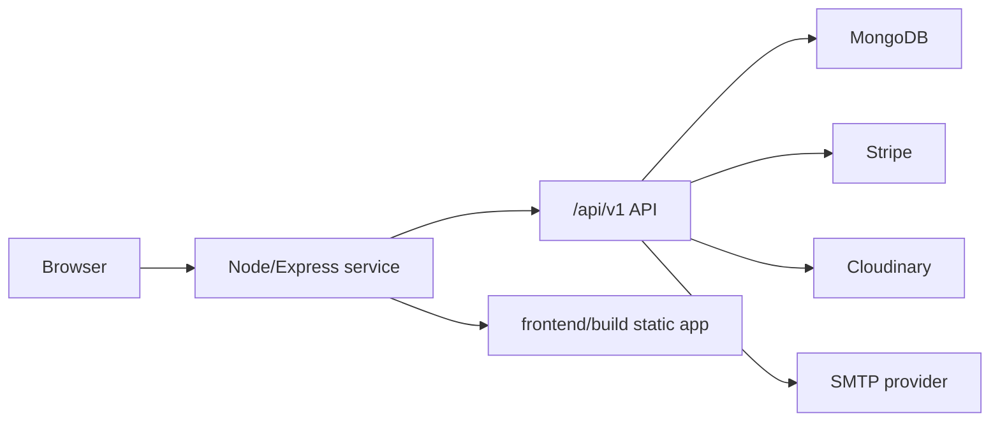

# Deployment

This document describes how to deploy the current Shopie application without inventing infrastructure that is not present in the repository.

## Deployment Model

The backend Express app can serve both:

- API routes mounted under `/api/v1`.
- The compiled React application from `frontend/build`.

That means the simplest production deployment is a single Node service:



## Required Environment Variables

Set these in the hosting platform. Do not commit real values.

```text
PORT=4000
NODE_ENV=PRODUCTION
DB_URI=
FRONTEND_URL=https://your-render-service.onrender.com
JWT_SECRET=
JWT_EXPIRE=5d
COOKIE_EXPIRE=5
CLOUDINARY_NAME=your-cloudinary-cloud-name
CLOUDINARY_API_KEY=your-cloudinary-api-key
CLOUDINARY_API_SECRET=
SMTP_SERVICE=gmail
SMTP_MAIL=your-email@example.com
SMTP_PASSWORD=
STRIPE_API_KEY=
STRIPE_SECRET_KEY=
```

Notes:

- `NODE_ENV=PRODUCTION` prevents the app from loading `backend/config/config.env`.
- Prefer `SMTP_*` in Render. Existing `SMPT_*` variables still work as legacy aliases.
- `FRONTEND_URL` should be the Render frontend/backend origin because this project is deployed as one Render web service.
- Use Stripe test keys for review/demo environments.

## Build and Start Commands

Install dependencies:

```bash
npm install
npm install --prefix frontend
```

Build frontend:

```bash
npm run build --prefix frontend
```

Start server:

```bash
npm start
```

The repository also includes:

```bash
npm run render-postbuild
```

This script installs frontend dependencies and builds the frontend. It is intended for Render-style build workflows.

## Render-Style Single Service

Recommended settings for a single Node web service:

| Setting | Value |
| --- | --- |
| Root directory | Repository root |
| Build command | `npm install` |
| Start command | `npm start` |
| Runtime | Node |
| Environment | Values from the required environment variable list |

The root `postinstall` script generates `frontend/build` automatically during Render deployment. If you prefer an explicit build command, use:

```bash
npm install && npm run build
```

After deployment, the Node process serves:

- Frontend route fallback through `backend/app.js`.
- API routes through `/api/v1`.

## Local Production Smoke Test

Run a production-like build locally:

```bash
npm install
npm install --prefix frontend
npm run build --prefix frontend
NODE_ENV=PRODUCTION PORT=4000 DB_URI=mongodb://127.0.0.1:27017/shopie JWT_SECRET=devsecret JWT_EXPIRE=5d COOKIE_EXPIRE=5 npm start
```

Then verify:

```bash
curl http://localhost:4000/api/v1/products
curl http://localhost:4000/api/v1/health
curl http://localhost:4000/
```

For authenticated flows, test through the browser so cookies are handled naturally.

## Post-Deployment Smoke Tests

Minimum checks after every deployment:

1. Open the homepage and product listing page.
2. Register a test user.
3. Log in and load `/account`.
4. Submit `GET /api/v1/me` through the browser session.
5. Search products through `/products?keyword=...`.
6. As an admin, create a product with an image.
7. Create a Stripe test payment intent from checkout.
8. Create an order after payment confirmation.
9. Trigger forgot-password email with a test user.
10. Check `/api/v1/health` returns `status: "ok"`.

## Render Notes

This repository is intended to deploy from GitHub to Render as one Node web service.

Render deployment expectations:

- Keep auto-deploy disabled if you want manual control after code changes.
- Let the root `postinstall` script generate `frontend/build`, or run `npm run build` explicitly in the Render Build Command.
- `frontend/build` is ignored and should be generated by Render, not committed.
- Do not commit `backend/config/config.env` or any `.env` file.
- Keep `FRONTEND_URL` aligned with the Render service URL.

## Operational Hardening Implemented

- `/api/v1/health` endpoint for platform health checks.
- Request validation for auth, product, order, review, and payment payloads.
- Rate limiting for auth, password reset, and payment routes.
- Production cookie options include `secure` and `sameSite`.
- API request logging uses structured JSON.
- GitHub CI checks backend syntax, backend smoke tests, frontend route smoke tests, secret scanning, and frontend build.

## Current Deployment Scope

- Render is documented as one Node web service that serves the API and compiled frontend.
- The in-memory rate limiter is appropriate for the current single-service deployment model.
- If the app is intentionally scaled horizontally later, rate limiting should be moved to shared infrastructure during that scaling work.
